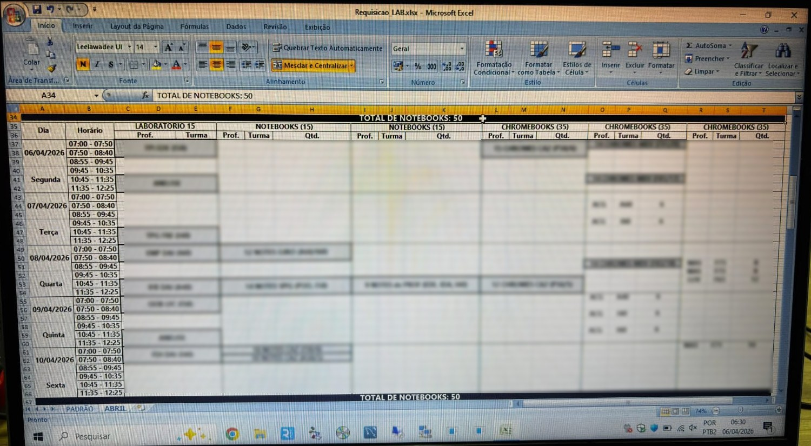
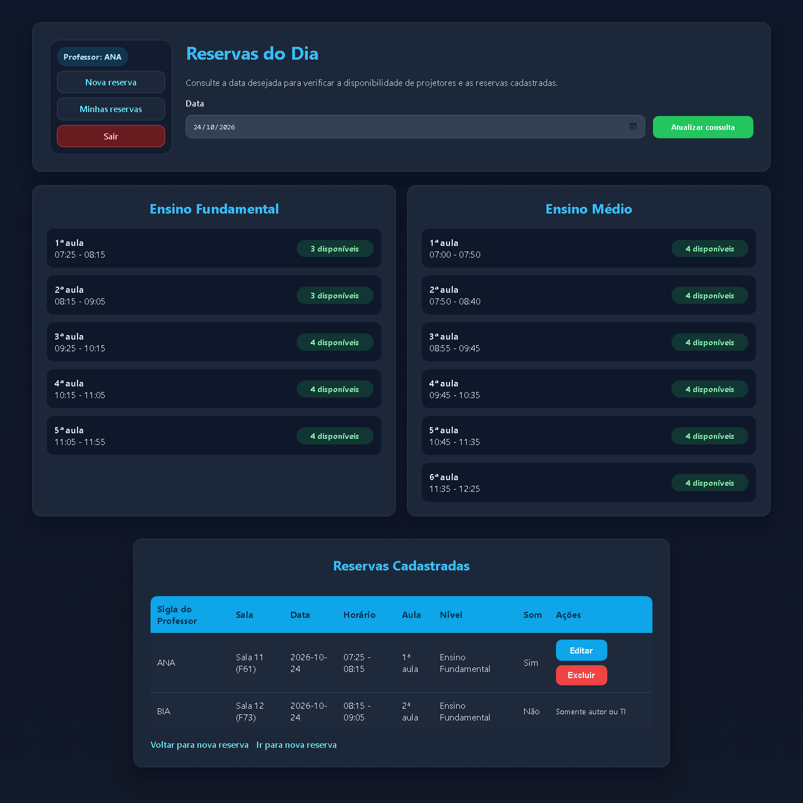
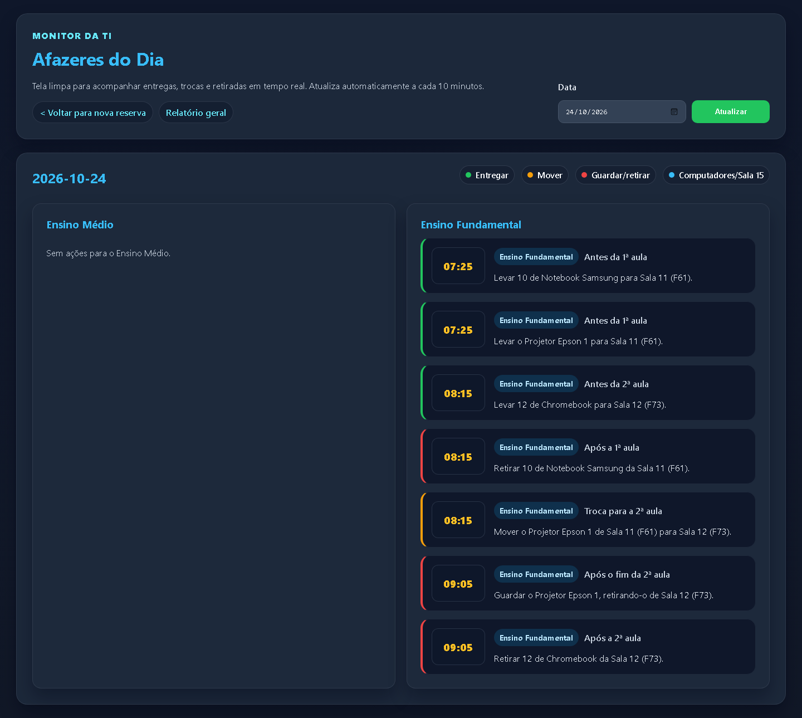
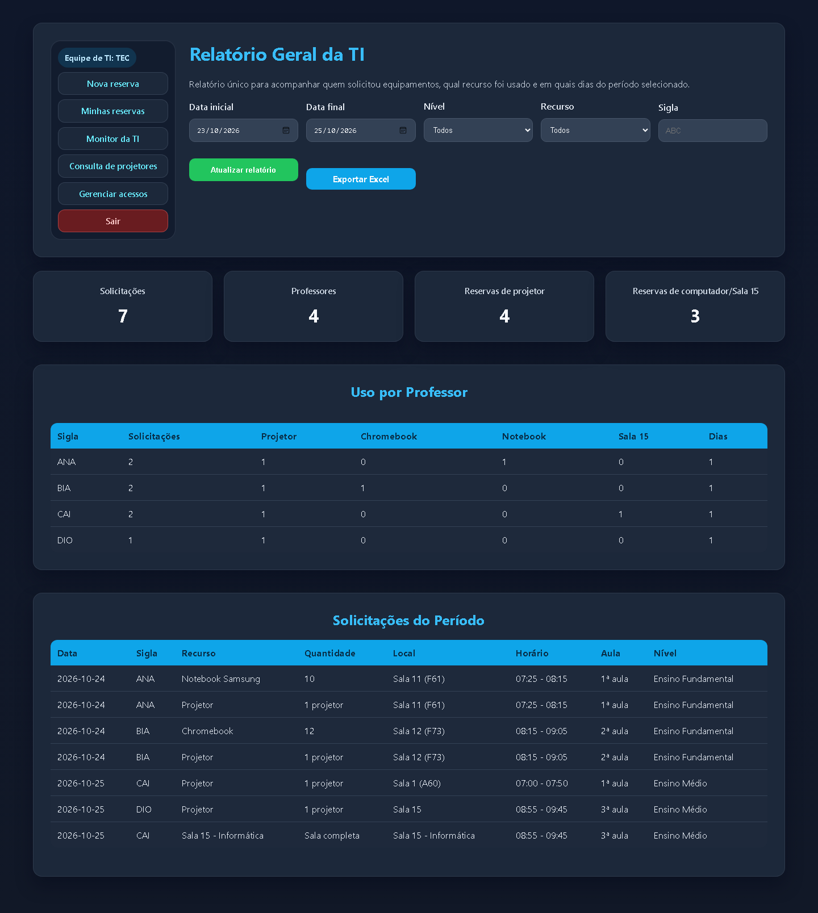

# Antes e depois

Nas fotos do controle antigo, borrei as siglas e os nomes dos professores. Os prints do sistema usam os dados fictícios da demo.

## Reserva de projetor

| Antes (planilha de papel) | Depois (sistema) |
|---|---|
|  |  |

Antes, a gente imprimia as planilhas a cada três meses e deixava na sala dos professores. Eles anotavam a sigla e a sala quando quisessem, menos no próprio dia da aula. Agora o professor reserva pelo site e já vê quantos projetores estão livres em cada horário.

## Reserva de computadores, notebooks, chromebooks e Sala 15

| Antes (planilha do Excel) | Depois (sistema) |
|---|---|
|  |  |

Antes, o professor pedia por e-mail ou pessoalmente, dizendo o dia, a sala e a quantidade. A gente conferia a disponibilidade, respondia se dava para atender e anotava no Excel. Os blocos em cinza eram as reservas fixas. Agora o pedido é feito no mesmo formulário do projetor, e o sistema confere na hora se ainda há equipamentos livres.

## O que a TI fazia todo dia

Antes, de manhã a gente tirava foto da planilha de projetor, mandava no grupo da TI no WhatsApp e marcava um X no dia. Depois ia para a sala da TI, tirava print do Excel e mandava no grupo também. A cada troca de aula, a gente olhava as duas coisas para decidir para onde levar cada projetor e notebook, o que trocar de sala e se precisava ligar a Sala 15. Isso tomava tempo o dia inteiro.

Agora o Monitor da TI junta projetores e computadores numa tela só e lista, em ordem de horário, o que levar, o que mover de uma sala para outra e o que retirar.

## Histórico

Antes, a equipe de TI não tinha histórico de quem reservou o quê, nem relatório de uso. Agora tudo fica registrado. O relatório mostra quem pediu o quê em cada período e exporta para Excel.

[Voltar para o README](README.md)
