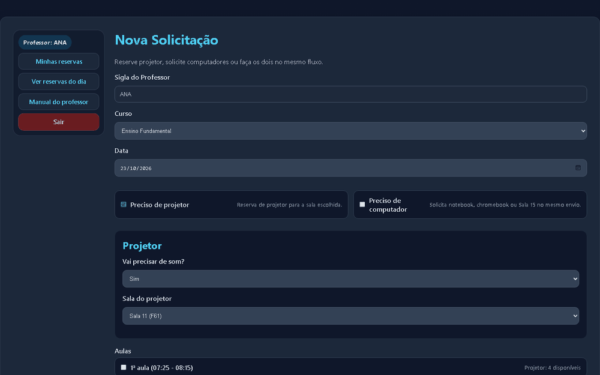
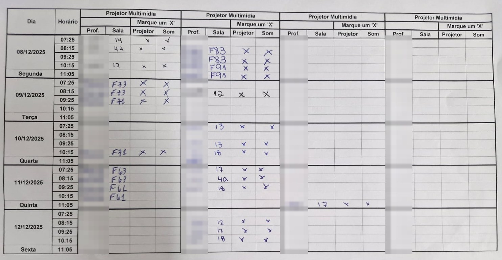
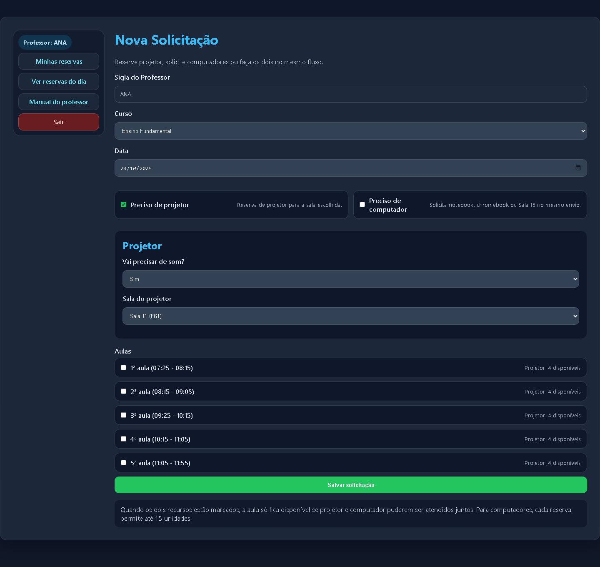

# Portal de Reservas de Equipamentos

Sistema web para organizar reservas de projetores, computadores e sala de informática em ambiente escolar.

A ideia do projeto é tirar esse controle de planilhas, papel e mensagens soltas, deixando professores e equipe de TI trabalhando no mesmo fluxo.

[Abrir a demo](https://projetores-demo.onrender.com/login) (dados fictícios; os acessos de teste estão logo abaixo).

## Por que fiz

Eu trabalhava na equipe de TI da escola, e as reservas ficavam em dois lugares diferentes:

- Projetores: a gente imprimia planilhas a cada três meses e deixava na sala dos professores. Eles anotavam quando quisessem, menos no próprio dia da aula.
- Computadores, notebooks, chromebooks e a Sala 15: o professor pedia por e-mail ou pessoalmente, a gente via a disponibilidade, respondia e anotava num Excel.

Todo dia de manhã a gente tirava foto da planilha de projetor, mandava no grupo da TI no WhatsApp e marcava um X no dia. Depois ia para a sala da TI, tirava print do Excel e mandava no grupo também.

A cada troca de aula, a gente olhava as duas coisas para decidir para onde levar cada projetor e notebook, o que trocar de sala e se precisava ligar a Sala 15. Era tempo perdido o dia todo, e deixava a equipe sobrecarregada. O sistema juntou tudo num lugar só e passou a mostrar pronto o que precisa ser feito em cada horário.

## Antes e depois

O [comparativo](COMPARATIVO.md) mostra cada parte do controle antigo ao lado do sistema. A reserva de projetor, por exemplo:

| Antes (papel) | Depois (sistema) |
|---|---|
|  |  |

## Acessos de teste

| Perfil | Usuário | Senha |
|---|---|---|
| Professor | ANA | demo123 |
| Equipe de TI | TEC | admin123 |

Os dados da demo são fictícios. O ambiente online usa acessos fixos e refaz os dados periodicamente para manter a demonstração limpa.

## O que o sistema faz

- Permite reservar projetores, notebooks, Chromebooks e a Sala 15.
- Bloqueia conflitos de horário, sala e disponibilidade de equipamentos.
- Mostra ao professor as próprias reservas em uma tela separada.
- Gera um monitor operacional para a equipe de TI acompanhar entregas, trocas e retiradas.
- Consolida as solicitações em um relatório geral com exportação para Excel.

## Autor

Gustavo Gurtler  
[LinkedIn](https://linkedin.com/in/gustavo-gurtler1) - [Portfólio](https://gustavogurtler.github.io/portfolio)

Feito com Python, Flask, SQLite, HTML/CSS/JavaScript, Gunicorn e Render.
